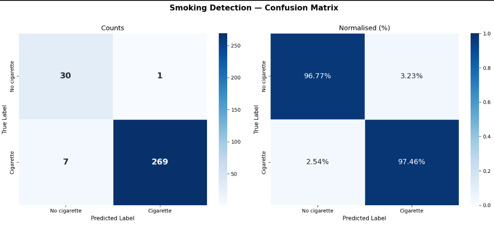
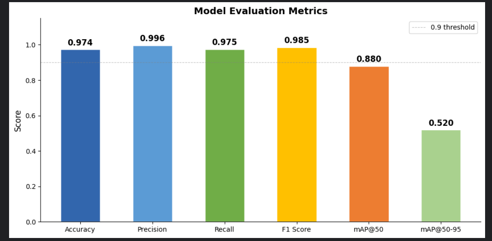

# Smoking Detection

Two models for detecting smoking (cigarettes) in images and video:

- **`yolo26/`** — a fine-tuned **YOLO26s** object detector (main model).
- **`mobilenet/`** — a lighter **MobileNet** classifier with a real-time webcam script.

Model weights and the full model card are on Hugging Face:
**[huggingface.co/basant18/Smoking-detection-YOLO26s](https://huggingface.co/basant18/Smoking-detection-YOLO26s)** · MobileNet: [basant18/Smoking-detection-MobileNet](https://huggingface.co/basant18/Smoking-detection-MobileNet)

## YOLO26s results

| Metric | Score |
|---|---|
| mAP@50 | 0.8796 |
| mAP@50-95 | 0.5198 |
| Precision | 0.9261 |
| Recall | 0.8814 |
| F1 | 0.9032 |

Image-level classification on 307 validation images: **97.4% accuracy** (cigarette F1 0.985, no-cigarette F1 0.882).
Note the validation set is imbalanced (276 cigarette vs 31 no-cigarette images).




## Training setup

- Dataset: Roboflow Universe, `pro-hiyaw / cigarettes-reality-2-trnm2` (version 1)
- Base weights: `yolo26s.pt` (Ultralytics)
- 200 epochs max, image size 800, batch 16, early stopping (patience 30)
- Augmentation: HSV saturation/value 0.2, rotation ±10°, horizontal flip 0.5
- Crash-resilient training: state saved every epoch, checkpoints uploaded to Hugging Face every 10 epochs, automatic resume

## Run it

```bash
pip install ultralytics roboflow huggingface_hub opencv-python
```

```python
from ultralytics import YOLO
model = YOLO("best.pt")   # download from the Hugging Face repo above
model.predict(source="your_image.jpg", imgsz=800, conf=0.5)[0].show()
```

## Files

| Path | Purpose |
|---|---|
| `yolo26/smoking-detection-yolo26.ipynb` | Training notebook (Kaggle) |
| `yolo26/evaluate_model.py` | Evaluation: metrics, confusion matrix, plots |
| `yolo26/test.py` | Quick inference test |
| `yolo26/data.yaml` | Dataset config |
| `mobilenet/realtime.py` | Real-time webcam inference with the MobileNet model |

## Notes

- Weights are not stored in this repository; download them from Hugging Face.
- The dataset comes from Roboflow Universe and keeps its own license.
- Educational and research use.
